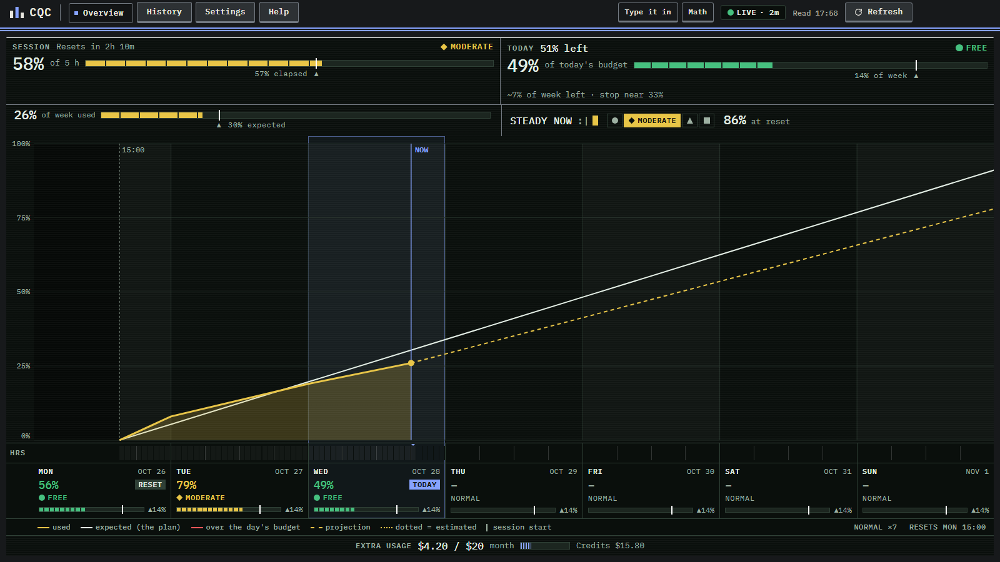
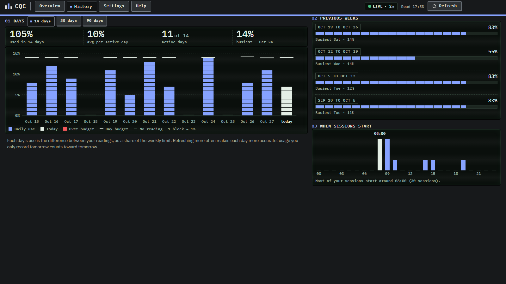

# Claude Quota Control

A small Windows app that answers two questions about your Claude plan:

- Can I use Claude until the weekly reset?
- How much can I use today?

Claude's usage page shows a percentage for the 5-hour session and one for the week. This app turns them into a daily budget, a projection to the reset and a plain verdict.



[Overview in the light theme](docs/screenshots/overview-light.png)

## Overview

- **Session and Today tiles.** How much of the 5-hour session is used, how much of it has passed, and when it resets. How much of today's budget is used and what is left.
- **Week bar and verdict band.** The week used against what the plan expected by now, and the answer to "can I use Claude until the reset?" in one of four levels, each with a color, a shape, a word and a face: Free, Moderate, Tight and Pause. The band also shows what would be left at the reset and which limit would stop you first.
- **Weekly chart.** Usage since the reset, the plan line, the projection to the reset and an hourly strip (HRS) of when the usage happened.
- **Day footer.** One cell per day with its use, its level and its budget.
- **Weekly plan.** Click a day in the Overview to set it to Light, Normal, Heavy or Off. Heavy days get a bigger share of what is left, days off get none.
- **Extra usage strip** (optional). Money spent this month against the monthly spend limit, and your credits, for plans that use extra usage.
- **Math drawer.** Every rule behind the numbers, filled in with your own values.
- **History.** Daily use against each day's budget over 14, 30 or 90 days, previous weeks, and the hours of day when your sessions start.
- **Tray card and taskbar strip.** A tray icon with a ring for the session, a quick card on click, and an optional small strip near the taskbar with what is left of today's budget.

English by default, Brazilian Portuguese in Settings. Dark (the default), light or system theme. The light theme prints the data on paper screens, or on CRT ones if you prefer.



## How we calculate

- **Rolling daily budget.** Today's budget is what was left of the week when the day began, times today's weight, divided by the sum of the weights from today until the reset (Heavy 2, Normal 1, Light 0.5, Off 0). Spend less and the next days grow; spend more and they shrink.
- **Projection.** Your average pace per plan day since the reset, carried to the next reset. The level counts the hours you would be without Claude before the reset if that pace holds (counting up to 100% of the limit, where Claude stops): 0 h is Free, up to 5 h (one session) Moderate, up to 24 h Tight, above that Pause. The verdict follows this level. A week at 95% or more always reads Pause. The first day and a half of plan days has no projection yet.
- **Session cuts.** The session level uses the share used: up to 50% Free, up to 75% Moderate, up to 90% Tight, above that Pause.
- **Today and the days.** Used divided by budget: up to 0.7 Free, up to 1.0 Moderate, up to 1.4 Tight, above that Pause.
- **Numbers as shown.** Levels are rated on the number as it appears on screen, so 4.6 h shown as 5 h is rated as 5 h.

The in-app Help ("How we calculate") and the Math drawer have the details.

## How reading works

There are three ways to get the numbers in. The app uses the most recent reading.

1. **Connect your Claude account.** You sign in on Claude's own page, in a window of the app. The app keeps the session, never your password. A refresh loads the usage page in a hidden window and reads only the usage response that the page itself receives. The app does not call Claude's API on its own.
2. **Type them in** from claude.ai/settings/usage.
3. **Claude Code collector** (optional). A status line script that passes the numbers along with every Claude Code reply.

A reading happens when you act: clicking Refresh, pressing F5 or Ctrl+Shift+R, an optional global shortcut, opening the app, coming back to it, or opening the tray card. There is no timer unless you turn on the optional one below. At most one reading per minute, with a hard time limit.

Claude's Consumer Terms do not allow automated access outside the API. An optional 5 minute timer exists in Settings > Advanced. It is off by default and turning it on shows that warning. Use it at your own risk.

If Claude changes the format of its usage data, the app does not guess. It shows an error and asks you to type the numbers in until it is updated.

## Privacy

Your data stays on your computer, in `%APPDATA%\Claude Quota Control`. The app goes online only to claude.ai when you refresh, and to GitHub when you check for updates. No analytics, no tracking. If you install the Claude Code collector, it also writes `~/.claude/claude-quota-control.json`.

## Limitations

- Unofficial. It depends on how Claude's usage page works today.
- Tested on the Pro plan only. Max plans should work the same way, but they have not been checked.
- Windows only.
- The taskbar strip has been tested on one Windows 11 machine.
- Extra usage is read from the page text, in English and Portuguese only.
- The installer is not code signed, so Windows SmartScreen may warn you. Choose "More info", then "Run anyway", or build it yourself.

## Install

Download the installer from the [latest release](https://github.com/KodusTheOnly/claude-quota-control/releases/latest). Windows 10 or 11.

## Build and test

You need Node.js 20 or newer.

```bash
npm install
npm start                      # run the app
npm test                       # unit tests
npx playwright install chromium   # once, for the layout tests
npm run test:layout            # layout tests for every screen
npm run dist                   # build the installer into dist/
```

## Credits

Text is set in IBM Plex Sans and numbers in IBM Plex Mono, both under the SIL Open Font License (`renderer/fonts/OFL-IBMPlex.txt`).

## Not affiliated with Anthropic

This is an independent project. It is not made by, endorsed by or affiliated with Anthropic. Claude is a trademark of Anthropic.

## License

[MIT](LICENSE)
